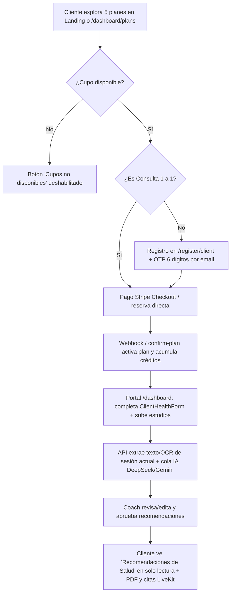
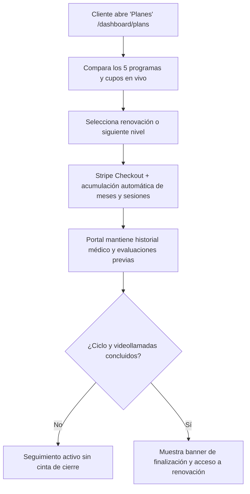

# Documento de Requisitos del Producto (PRD)
## NELHEALTHCOACH - Plataforma Integral de Coaching de Salud

**Versión:** 1.5.0  
**Fecha:** Noviembre 2026  
**Autor:** Equipo de Desarrollo NELHEALTHCOACH  
**Estado:** En producción — Portal de Clientes, 5 Planes Comerciales, Cupos y Suite Multi-App

---

## Tabla de Contenidos

1. [Resumen Ejecutivo](#1-resumen-ejecutivo)
2. [Objetivos del Producto](#2-objetivos-del-producto)
3. [Público Objetivo](#3-público-objetivo)
4. [Arquitectura del Sistema](#4-arquitectura-del-sistema)
5. [Requisitos Funcionales](#5-requisitos-funcionales)
6. [Requisitos No Funcionales](#6-requisitos-no-funcionales)
7. [Flujos de Usuario](#7-flujos-de-usuario)
8. [Stack Tecnológico](#8-stack-tecnológico)
9. [Roadmap de Desarrollo](#9-roadmap-de-desarrollo)
10. [Métricas de Éxito](#10-métricas-de-éxito)
11. [Consideraciones de Seguridad](#11-consideraciones-de-seguridad)
12. [Consideraciones de Privacidad](#12-consideraciones-de-privacidad-y-cumplimiento-regulatorio)
13. [Apéndices](#13-apéndices)

---

## 1. Resumen Ejecutivo

### 1.1 Visión del Producto
NELHEALTHCOACH es una plataforma integral de coaching de salud diseñada para conectar profesionales de la salud con clientes y pacientes, facilitando la contratación de programas, gestión clínica de evaluaciones, generación de recomendaciones asistida por IA supervisada, videollamadas con transcripción y seguimiento multi-mes en un entorno digital seguro y moderno.

### 1.2 Propuesta de Valor
- **Para Coaches de Salud:** Centro de mando unificado para gestionar expedientes cifrados, filtrar pacientes por plan, administrar cupos comerciales, revisar/editar/aprobar planes asistidos por IA y conducir sesiones por videollamada.
- **Para Clientes y Pacientes:** Portal propio con registro verificado por OTP, contratación directa de 5 programas vía Stripe Checkout, completado de historial clínico embebido, agenda de videollamadas con apertura programada y lectura/descarga PDF de recomendaciones aprobadas por su asesor.
- **Para la Industria:** Plataforma escalable multi-idioma (6 idiomas) con blindaje RGPD Art. 9, CCPA/CPRA, FTC *Click to Cancel*, California AB 5 y arbitraje JAMS.

### 1.3 Diferenciadores Clave
1. **Arquitectura Monorepo:** 5 aplicaciones Next.js 16.3.6 coordinadas con tipos compartidos (`@nel/types`).
2. **Procesamiento e Inteligencia Artificial Multi-Modelo y por Plan:** Extracción LOCAL de documentos médicos (`pdf-parse`, `mammoth`, OCR fallback para PDFs escaneados) por sesión actual (`document-selection.ts`) + razonamiento clínico y dietético en **DeepSeek V4 Flash** con fallback automático a **Google Gemini** (`gemini-2.5-flash` / `gemini-4-hydrogen`), diferenciado según duración del plan (3 semanas progresivas `weeklyPhases` en *Reto Tres NEL* vs. ciclos de 4 semanas en planes mensuales) y análisis de fotografías de recetas.
3. **Modelo Comercial de 5 Planes con Control de Cupos:** Catálogo único sincronizado entre Landing, Formularios, Dashboard y API, con cobro en Stripe Checkout, acumulación automática de créditos al renovar o escalar de plan y bloqueo en tiempo real de cupos (`plan_quotas`).
4. **Seguridad de Nivel Médico y Telecomunicaciones:** Cifrado AES-256 campo a campo, RBAC estricto (`coach`, `admin`, `client`), ventana temporal de ingreso a LiveKit (15 minutos antes de la cita) y consentimiento previo para transcripción con Deepgram.

---

## 2. Objetivos del Producto

### 2.1 Objetivos Principales (OKRs)

#### **Objetivo 1: Crear una plataforma integral de coaching de salud y portal de cliente**
- **KR1:** Operar 5 aplicaciones integradas (`landing`, `blog`, `form`, `dashboard`, `api`) con experiencia dual para Coaches y Clientes.
- **KR2:** Soportar el ciclo completo de los 5 programas comerciales (`consult_1on1`, `reto_tres_nel`, `plan_1_reinicio`, `plan_2_transformacion`, `plan_3_maestria`) con cupos configurables y renovaciones con acumulación de créditos.
- **KR3:** Lograr 99.5% de disponibilidad del sistema en arquitectura serverless.

#### **Objetivo 2: Garantizar seguridad, privacidad y aislamiento de datos médicos**
- **KR1:** Cifrado AES-256 campo a campo para PII y expedientes clínicos, con aislamiento estricto por rol (`coach`/`admin` vs `client`).
- **KR2:** Cumplimiento estricto con RGPD Art. 9, CCPA/CPRA, FTC *Click to Cancel*, California AB 5 y Cal. Penal Code § 632 (consentimiento previo de grabación).
- **KR3:** Verificación automatizada mediante `security-gate.test.ts` (OWASP), cero secretos hardcodeados y limpieza garantizada en base de datos.

#### **Objetivo 3: Optimizar experiencia de usuario e internacionalización**
- **KR1:** Interfaz limpia sin elementos redundantes, con portal de cliente estructurado en 4 estados y estados skeleton pulsantes (Principio Anti-AI).
- **KR2:** Cobertura completa en 6 idiomas (`es`, `en`, `fr`, `it`, `pt`, `de`) tanto en UI como en traducción dinámica FASE 4 de recomendaciones IA y PDFs.
- **KR3:** Cumplimiento W3C WCAG 2.1 AA y optimización de Core Web Vitals.

---

## 3. Público Objetivo

### 3.1 Personas Principales

#### **Coaches de Salud y Administrador (Usuario Primario)**
- **Demografía:** Profesionales de salud certificados y equipo coordinador (30-60 años)
- **Necesidades:**
  - Gestión eficiente de múltiples clientes agrupados por plan contratado
  - Control operativo de cupos disponibles por producto (`plan_quotas`)
  - Acceso rápido a historiales médicos cifrados y estudios de la evaluación en curso
  - Supervisión, edición, aprobación y envío de recomendaciones generadas con IA
  - Videollamadas seguras con transcripción clínica automática
- **Frustraciones:**
  - Sistemas fragmentados entre formularios, cobros, videollamadas y seguimiento
  - Procesos manuales repetitivos de redacción dietética y clínica
  - Riesgo de sobreventa de plazas o ingreso anticipado a salas de video

#### **Clientes / Pacientes (Usuario Secundario)**
- **Demografía:** Adultos que contratan programas de salud evolutiva y cetogénica (25-70 años)
- **Necesidades:**
  - Contratar cualquiera de los 5 planes desde la landing o portal de planes con transparencia de cupos
  - Completar su historial médico sin fricción y consultar el progreso de su programa
  - Visualizar su agenda de videollamadas con botón de acceso habilitado en el horario exacto
  - Consultar y descargar en PDF sus recomendaciones aprobadas una vez listas
- **Frustraciones:**
  - Formularios médicos desconectados del pago o seguimiento
  - Confusión sobre fechas de videollamadas o estado de sus recomendaciones
  - Interfaces recargadas o con botones duplicados

### 3.2 Mercado Objetivo
- **Segmento:** Coaching de salud preventivo, nutrición cetogénica evolutiva y optimización metabólica
- **Tamaño de Mercado:** $7 billones globalmente (salud digital)
- **Crecimiento:** 25% CAGR en salud digital
- **Competencia:** Plataformas como BetterHelp o Noom, diferenciándose por integración clínica end-to-end, OCR/análisis de biomarcadores con óptica keto y supervisión humana obligatoria.

---

## 4. Arquitectura del Sistema

### 4.1 Diagrama de Arquitectura

```
┌────────────────────────────────────────────────────────────────────────────┐
│                        NELHEALTHCOACH PLATFORM (v1.5)                      │
├────────────────────────────────────────────────────────────────────────────┤
│                                                                            │
│  ┌────────────┐  ┌────────────┐  ┌────────────┐  ┌──────────────────────┐  │
│  │  Landing   │  │    Blog    │  │ Formularios│  │ Dashboard + Portal   │  │
│  │ (Next 16)  │  │ (Next 16)  │  │ (Next 16)  │  │  (Next 16, Dual UI)  │  │
│  └─────┬──────┘  └─────┬──────┘  └─────┬──────┘  └──────────┬───────────┘  │
│        │               │               │                    │              │
│        └───────────────┴───────────────┴────────────────────┘              │
│                                        │                                   │
│                             ┌──────────▼──────────┐                        │
│                             │   API Backend       │                        │
│                             │ (Next 16 App Router)│                        │
│                             └──────────┬──────────┘                        │
│                                        │                                   │
├────────────────────────────────────────┼───────────────────────────────────┤
│  Cloud & AI Services                   │                                   │
│  ┌─────────┐ ┌─────────┐ ┌─────────┐ ┌─┴───────┐ ┌──────────┐ ┌─────────┐  │
│  │ MongoDB │ │ AWS S3  │ │ Stripe  │ │DeepSeek │ │  Gemini  │ │ LiveKit │  │
│  │ + Cola  │ │ + SES/  │ │Checkout │ │V4 Flash │ │+ OCR loc.│ │+Deepgram│  │
│  │ ai_jobs │ │ Resend  │ │& Connect│ │         │ │          │ │         │  │
│  └─────────┘ └─────────┘ └─────────┘ └─────────┘ └──────────┘ └─────────┘  │
└────────────────────────────────────────────────────────────────────────────┘
```

### 4.2 Componentes del Sistema

#### **4.2.1 Aplicación Landing (`apps/landing`)**
- **Propósito:** Marketing, calificación de leads, exhibición de los 5 planes comerciales con cupos en tiempo real y transparencia legal
- **Tecnologías:** Next.js 16.3.6 (Pages Router), React 19.1.0, Tailwind CSS, `i18next`
- **Características:**
  - Catálogo sincronizado con `GET /api/plans` mostrando cupos en vivo (*Cupos no disponibles* cuando el cupo está lleno)
  - Flujo inteligente de contratación: *Consulta 1 a 1* con reserva directa sin cuenta obligatoria vs. los 4 programas con continuidad vía `/register/client?plan=...`
  - Formulario de captación con precalificación de compromiso (escala 1 a 10) y filtro pedagógico de 3 pasos
  - Suite legal completa (`/politica-privacidad`, `/terminos-condiciones`, `/aviso-legal`, `/cookies`, `/reembolsos`) + Navbar adaptativo contextual y CMP con respeto de señales GPC
  - i18n multi-idioma (es, en, fr, it, pt, de)

#### **4.2.1b Aplicación Blog (`apps/blog`)**
- **Propósito:** Biblioteca de divulgación científica y nutrición evolutiva
- **Tecnologías:** Next.js 16.3.6, React 19.1.0, Tailwind CSS
- **Características:**
  - Renderizado SSR/SSG optimizado para indexación y SEO
  - Metadatos estructurados JSON-LD (`BlogPosting`, `Blog`) y `hreflang` para 6 idiomas
  - Generación dinámica de RSS 2.0 y sitemap XML multilingüe
  - Suite de pruebas de integración automatizadas (76 checks)

#### **4.2.2 Aplicación de Formularios (`apps/form`)**
- **Propósito:** Captura de datos clínicos de pacientes y formalización contractual
- **Tecnologías:** Next.js 16.3.6, React 19.1.0, React Hook Form, Yup, `i18next`
- **Características:**
  - Formularios multi-paso validados en tiempo real con progreso automático
  - Subida segura de documentos médicos a AWS S3 mediante URLs prefirmadas
  - Paso 6 de Contrato y Consentimiento Desacoplado (RGPD Art. 9, renuncia a desistimiento, aviso de IA y arbitraje JAMS)
  - Compatibilidad con contratación/renovación (`planId`) sin fricción cuando el cliente proviene del portal

#### **4.2.3 Dashboard de Coaching y Portal de Clientes (`apps/dashboard`)**
- **Propósito:** Centro de operaciones clínicas para coaches/admin y portal autogestionado para clientes
- **Tecnologías:** Next.js 16.3.6, React 19.1.0, Tailwind CSS, Stripe, LiveKit, Deepgram, `jsPDF`
- **Características:**
  - **Experiencia Coach/Admin:** Listado de clientes con **filtro por plan**, gestión operativa de cupos por plan (`plan_quotas`), expediente clínico con selección de documentos por sesión, editor/aprobador de planes IA (`3` o `4` semanas según plan), análisis de fotos de recetas, finanzas Stripe Connect, agenda LiveKit y cancelación FTC (`/dashboard/trial/cancel`).
  - **Experiencia Cliente (`/dashboard`, `/dashboard/plans`, `/dashboard/my-profile`, `/register/client`):**
    - Sidebar simplificado sin enlaces redundantes: **Inicio**, **Planes**, acceso único inferior (**Ver mi perfil**) y **Cerrar Sesión**.
    - Portal en 4 estados (`sin plan`, `consulta 1 a 1`, `historial pendiente con ClientHealthForm`, `programa activo/completado`).
    - Cinta de finalización condicional (`programCompleted === true` únicamente al concluir duración y videollamadas).
    - Lista cronológica de videollamadas del plan con botón deshabilitado hasta 15 min antes (`/video/join`).
    - Card **Tu Perfil de Salud** indicando recomendaciones en análisis o aprobadas, con visor **solo lectura + descarga PDF** y acceso único a perfil y WhatsApp.
    - Comparador de los 5 planes (`/dashboard/plans`) alineado responsive en 5 columnas con disponibilidad en vivo, contratación, renovación y cambio de plan con créditos acumulados.

#### **4.2.4 API Backend (`apps/api`)**
- **Propósito:** Lógica de negocio, pagos, videollamadas y pipeline de IA
- **Tecnologías:** Next.js 16.3.6 App Router, MongoDB 6.0 / Mongoose 8.0, Stripe, AWS S3/SES, Resend, DeepSeek V4 Flash, Google Gemini, LiveKit Server SDK, Deepgram SDK 5.0
- **Características:**
  - Autenticación JWT multi-rol (`coach`, `admin`, `client`), autoregistro OTP de 6 dígitos (`/api/auth/client/*`) y cifrado AES-256
  - Catálogo único de 5 planes (`plans.ts`), control de cupos (`/api/plans`, `/api/plan-quotas`), Stripe Checkout (`/api/payments/plan-checkout`, `confirm-plan`, webhooks idempotentes)
  - Endpoint consolidado `/api/client-portal/me` con cálculo de estado, agenda proyectada de videollamadas (`buildClientVideoSessionSchedule`) y finalización (`evaluateProgramCompletionState`)
  - Cola asíncrona propia sobre MongoDB (`ai_jobs`, 202 queued, lease 6 min, hasta 3 reintentos)
  - Pipeline secuencial multi-fase diferenciado por plan (`weeklyPhases` 3 semanas para *Reto Tres NEL* vs. 4 semanas en planes mensuales), traducción dinámica FASE 4, OCR fallback local y análisis de imágenes de recetas (`/api/recipes/analyze-image`)
  - Ventana de ingreso LiveKit (`403 SESSION_NOT_YET_STARTED` antes de 15 min) y generación de PDFs (`pdfkit` / `Uint8Array`)

### 4.3 Base de Datos

#### **Esquemas Principales**
```javascript
// Usuarios (Coaches y Administradores)
User {
  _id: ObjectId
  email: String (único)
  passwordHash: String
  role: ['coach', 'admin']
  profile: { name, specialization, licenseNumber, phone }
  createdAt: Date
  updatedAt: Date
}

// Cuentas y Expedientes de Clientes (ClientAccount / HealthForm)
ClientAccount {
  _id: ObjectId
  email: String (único)
  passwordHash: String
  isVerified: Boolean
  otpCodeHash: String
  otpExpiresAt: Date
  selectedPlanId: String // 'consult_1on1' | 'reto_tres_nel' | 'plan_1_reinicio' | 'plan_2_transformacion' | 'plan_3_maestria'
  activePlan: {
    planId: String
    status: String
    purchasedAt: Date
    expiresAt: Date
    monthsIncluded: Number
    monthsUsed: Number
    livekitSessionsTotal: Number
    livekitSessionsUsed: Number
  }
  coachId: ObjectId (ref: User)
  personalData: Object (cifrado AES-256)
  medicalData: Object (cifrado AES-256)
  documents: [{
    name: String
    s3Key: String
    evaluationSessionId: String
    uploadedAt: Date
    processedData: Object // Extraído localmente (pdf-parse/mammoth/OCR fallback), analizado por Gemini
  }]
  aiProgress: {
    sessions: [{
      sessionNumber: Number
      status: ['draft', 'approved', 'sent']
      weeklyPhases: Array // Fases semanales progresivas (3 semanas en Reto Tres NEL)
      translations: Object // es/en/fr/it/pt/de
    }]
    generationError: String
  }
  createdAt: Date
  updatedAt: Date
}

// Control de Cupos por Plan (PlanQuota)
PlanQuota {
  _id: ObjectId
  planId: String (único)
  maxCapacity: Number | null
  isPaused: Boolean
  updatedBy: ObjectId
  updatedAt: Date
}
```

---

## 5. Requisitos Funcionales

### 5.1 Gestión de Usuarios, Roles y Portal de Cliente

#### **RF-001: Registro, Verificación OTP y Autenticación Multi-Rol**
- **ID:** RF-001
- **Prioridad:** Crítica
- **Descripción:** Coaches, administradores y clientes deben registrarse y autenticarse con aislamiento estricto por rol.
- **Criterios de Aceptación:**
  1. Registro de coaches con verificación por email y contrato AB 5.
  2. Autoregistro de clientes (`/register/client`) con contraseña robusta y verificación OTP de 6 dígitos por email (vigencia 15 min).
  3. Login unificado con JWT tokens (`coach`, `admin`, `client`), recuperación de contraseña y prevención de enumeración de cuentas.

#### **RF-002: Catálogo de 5 Planes, Pagos Stripe y Control de Cupos**
- **ID:** RF-002
- **Prioridad:** Crítica
- **Descripción:** Venta en línea de 5 programas comerciales con límites de capacidad controlados desde el dashboard administrativo.
- **Criterios de Aceptación:**
  1. Catálogo único (`consult_1on1`, `reto_tres_nel`, `plan_1_reinicio`, `plan_2_transformacion`, `plan_3_maestria`) consultable en `/api/plans`.
  2. Administración de cupos (`plan_quotas`) por el coach/admin; cuando un plan alcanza su tope o está pausado, el checkout responde `409 QUOTA_FULL` y el botón UI cambia a **Cupos no disponibles**.
  3. Pago único vía Stripe Checkout (`/api/payments/plan-checkout`), confirmación idempotente y acumulación automática de meses/evaluaciones y sesiones LiveKit al renovar o cambiar de plan.

### 5.2 Gestión de Pacientes y Portal de Seguimiento

#### **RF-003: Vista de Lista de Clientes con Filtro por Plan**
- **ID:** RF-003
- **Prioridad:** Alta
- **Descripción:** Coaches pueden filtrar, agrupar y buscar clientes según su plan contratado y estado.
- **Criterios de Aceptación:**
  1. Lista paginada con búsqueda por nombre/email e identificador.
  2. Filtro dedicado por plan contratado (`planId`) y estado de evaluación.
  3. Panel superior de gestión rápida de cupos por plan para el administrador.

#### **RF-004: Portal del Cliente (`/dashboard`, `/dashboard/plans`, `/dashboard/my-profile`)**
- **ID:** RF-004
- **Prioridad:** Alta
- **Descripción:** Experiencia limpia y no redundante para clientes autenticados en 4 estados posibles.
- **Criterios de Aceptación:**
  1. Sidebar específico para `client` con **Inicio**, **Planes**, acceso único inferior **Ver mi perfil** y **Cerrar Sesión**.
  2. Estado 1 (sin plan), Estado 2 (Consulta 1 a 1), Estado 3 (historial pendiente con `ClientHealthForm` embebido) y Estado 4 (programa activo o completado).
  3. Cinta de felicitación de fin de programa visible exclusivamente cuando `programCompleted === true`.
  4. Vista `ClientProfileView` en modo `client` con tarjeta **Recomendaciones de Salud** en solo lectura + descarga PDF directa (sin edición por parte del cliente y sin textos duplicados).

### 5.3 Formularios, IA y Documentos Médicos

#### **RF-005: Formularios de Evaluación y Selección de Documentos**
- **ID:** RF-005
- **Prioridad:** Crítica
- **Descripción:** Captura de historial médico y análisis inteligente restringido a los documentos de la evaluación vigente.
- **Criterios de Aceptación:**
  1. Formularios multi-paso en `apps/form` y `ClientHealthForm` embebido en `apps/dashboard`.
  2. Subida a AWS S3 (PDF, JPG, PNG, DOCX hasta 10MB) y extracción local (`pdf-parse`, `mammoth`, OCR fallback para PDFs escaneados).
  3. Selección automática (`document-selection.ts`) de documentos pertenecientes a la sesión actual más resumen de sesiones previas.

#### **RF-006: Generación de Recomendaciones IA Diferenciada por Plan y Recetas**
- **ID:** RF-006
- **Prioridad:** Crítica
- **Descripción:** Pipeline secuencial asíncrono con DeepSeek V4 Flash + fallback Gemini y supervisión humana obligatoria.
- **Criterios de Aceptación:**
  1. Cola propia (`ai_jobs`) respondiendo `202 queued` en < 1s con worker-on-poll y lease de 6 min.
  2. En *Reto Tres NEL* genera 3 semanas diferenciadas (`weeklyPhases`); en Planes 1, 2 y 3 mantiene ciclos de 4 semanas.
  3. En estado `draft` solo es visible/editable por el coach; al pasar a `approved` / `sent` se habilita en el portal del cliente en solo lectura + PDF.
  4. Análisis nutricional de fotografías de recetas vía `/api/recipes/analyze-image`.

### 5.4 Videollamadas, Agenda y Cumplimiento

#### **RF-007: Agenda Proyectada y Ventana de Acceso LiveKit + Deepgram**
- **ID:** RF-007
- **Prioridad:** Alta
- **Descripción:** Programación automática o manual de videollamadas con apertura bloqueada hasta 15 minutos antes.
- **Criterios de Aceptación:**
  1. Tarjeta **Mis Videollamadas** en el portal mostrando las citas incluidas en el plan con botón deshabilitado en gris hasta el inicio de la ventana permitida.
  2. `/api/video/token` valida ventana de acceso devolviendo `403 SESSION_NOT_YET_STARTED` con `scheduledAt` y `unlocksAt` antes de los 15 minutos previos.
  3. Pre-Call Consent Gate obligatorio antes de activar transcripción en tiempo real con Deepgram en `/video/join`.

#### **RF-008: Generación de Reportes PDF y Multi-Idioma**
- **ID:** RF-008
- **Prioridad:** Media
- **Descripción:** Descarga de planes clínicos en el idioma del cliente (6 idiomas) respetando estructura de 3 o 4 semanas.
- **Criterios de Aceptación:**
  1. Generación streaming vía `Uint8Array` compatible con Next.js 16 y descarga directa desde el modal tanto para coach como para cliente.
  2. Inclusión de `weeklyPhases` cuando el cliente cursa el *Reto Tres NEL* y disclaimer médico localizado.

---

## 6. Requisitos No Funcionales

### 6.1 Rendimiento
- **NF-001 (Tiempos de Respuesta):** Carga inicial < 2s, respuestas de encolado IA < 1s (`202`), worker completo dentro del límite serverless (< 300s).

### 6.2 Seguridad
- **NF-003 (Autenticación y Autorización):** JWT con expiración controlada, RBAC estricto (`coach`, `admin`, `client`), OTP de 6 dígitos con caducidad y anti-enumeración.
- **NF-004 (Protección de Datos):** TLS 1.3+, cifrado AES-256 campo a campo, cero secretos hardcodeados en código o pruebas (`client-plans-flow.test.ts` genera contraseñas en runtime).

### 6.3 Disponibilidad y Confiabilidad
- **NF-005 (Disponibilidad):** 99.5% uptime sobre Vercel + MongoDB Atlas.
- **NF-006 (Tolerancia a Fallos):** Cola `ai_jobs` con lease de 6 min y hasta 3 reintentos; fallback automático en runtime de DeepSeek a Google Gemini ante interrupciones de proveedor.

### 6.4 Usabilidad, SEO e Internacionalización
- **NF-007 (Experiencia de Usuario):** WCAG 2.1 AA (`id`/`htmlFor`, `Escape`, `focus-visible`, contraste >= 4.5:1), Principio Anti-AI con skeletons `animate-pulse` y eliminación de botones redundantes en portal y sidebar.
- **NF-008 (Internacionalización):** 6 idiomas completos (`es`, `en`, `fr`, `it`, `pt`, `de`) incluyendo todo el portal de cliente (`Inicio`, `Planes`, `Ver mi perfil`, estados de recomendaciones pendientes/aprobadas, agenda de video y comparador de planes) + traducción dinámica FASE 4 de planes y PDFs.
- **NF-009 / NF-010 (SEO Técnico & Cabeceras HTTP):** Indexación selectiva (`Allow` en Landing/Blog con sitemaps multilingües y JSON-LD; `Disallow` + `noindex` en Dashboard/Form), cabeceras de seguridad HTTP y `<Image fill sizes="...">`.

### 6.5 Mantenibilidad y Testing
- **NF-011 (Suite TDD y Security Gate OWASP):**
  - Suite automatizada en `apps/api/tests/` con perfiles desechables y limpieza garantizada en `finally`: `security-gate.test.ts` (21 checks OWASP), `client-plans-flow.test.ts` (81 checks), `plan-quotas.test.ts` (21 checks), `document-selection.test.ts`, `blog.test.ts` (76 checks), `waitlist.test.ts`, `free-sessions.test.ts`, `queue.test.ts`, `translate.test.ts`, `pdf-route.test.ts`, `db-clean.test.ts` y suites E2E con LLM real.

---

## 7. Flujos de Usuario

### 7.1 Flujo de Contratación, Registro OTP y Seguimiento de Cliente



### 7.2 Flujo de Renovación o Cambio de Plan y Fin de Programa



---

## 8. Stack Tecnológico

### 8.1 Frontend
- **Framework:** Next.js 16.3.6 (Pages Router en Landing/Dashboard/Form; App Router en Blog/API)
- **UI Library:** React 19.1.0
- **Estilos:** Tailwind CSS 4.0 / PostCSS
- **Formularios:** React Hook Form + Yup
- **Exportación PDF:** `jsPDF` + `jspdf-autotable` (cliente) y descarga binaria API
- **i18n:** `i18next` + `react-i18next` (6 idiomas)

### 8.2 Backend
- **Runtime:** Node.js 18+
- **Framework:** Next.js 16.3.6 API Routes (App Router)
- **Base de Datos:** MongoDB 6.0 + Mongoose 8.0 (incl. cola `ai_jobs` y `plan_quotas`)
- **Pagos:** Stripe Checkout, Stripe Connect & Webhooks idempotentes
- **IA & Audio:** DeepSeek V4 Flash (`deepseek-chat`), Google Gemini (`gemini-2.5-flash` / `gemini-4-hydrogen`), Deepgram SDK 5.0
- **Documentos y PDF:** `pdf-parse`, `mammoth`, `tesseract.js` (OCR fallback local), `pdfkit`, `sharp`
- **Videollamadas:** LiveKit Cloud + `livekit-server-sdk`
- **Email & Storage:** Resend + AWS SES (fallback), AWS S3

### 8.3 Infraestructura y Desarrollo
- **Hosting:** Vercel Hobby (`maxDuration` <= 300s)
- **Lenguaje & Monorepo:** TypeScript 5.8.3, Turbo, npm, ESLint

---

## 9. Roadmap de Desarrollo

### Fase 1-3: Plataforma Clínica Base, Blindaje Legal y Blog (Completadas)
- Arquitectura monorepo, cifrado AES-256, bot detection, rate limiter y guardrails.
- Cola propia sobre MongoDB (`ai_jobs`), traducción dinámica FASE 4 en 6 idiomas, generación PDF y blog multilingüe SEO (`apps/blog`).
- Cumplimiento legal RGPD Art. 9, CCPA, ePrivacy CMP, FTC *Click to Cancel*, California AB 5, Pre-Call Consent Gate Deepgram y arbitraje JAMS.

### Fase 4: Portal de Clientes, 5 Planes Comerciales y IA por Programa (Completada - v1.5.0)
- Catálogo comercial de 5 planes con Stripe Checkout, acumulación de créditos y control administrativo de cupos (`plan_quotas`) + filtro por plan en listado de clientes.
- Portal unificado para clientes (`Inicio`, `Planes`, `Ver mi perfil`, `/register/client` OTP, 4 estados, banner condicional `programCompleted`).
- Agenda automática de videollamadas con bloqueo temporal de 15 min (`403 SESSION_NOT_YET_STARTED`), diferenciación de planes IA en 3 semanas (`weeklyPhases` para *Reto Tres NEL*) vs. 4 semanas, análisis de fotos de recetas y selección de documentos de evaluación actual con OCR fallback.

---

## 10. Métricas de Éxito

### 10.1 Métricas de Producto y Negocio
- **Conversión de Planes:** Activación sin fricción desde landing y portal con tasa de abandono reducida en registro OTP y Stripe Checkout.
- **Control Operativo:** 0 sobreventas de cupos en programas con límite (`plan_quotas`).
- **Adopción y Satisfacción:** NPS > 70, CSAT > 85% y eliminación de dudas sobre horarios de videollamada o estado de recomendaciones.

### 10.2 Métricas Técnicas
- **Performance:** Page Load Time < 2s, respuestas de encolado IA < 1s.
- **Disponibilidad y Calidad:** 99.5% uptime, 0 errores TypeScript/ESLint, 0 datos de prueba residuales en DB (`db-clean`).

---

## 11. Consideraciones de Seguridad
- **Cumplimiento Normativo:** HIPAA-ready, GDPR/RGPD Art. 9, LGPD, CCPA/CPRA, Cal. Penal Code § 632.
- **Controles Técnicos:** Autenticación JWT multi-rol, OTP temporal hasheado, RBAC estricto (clientes solo acceden a sus datos y sesiones `approved`/`sent`), TLS 1.3+, AES-256 en reposo y prevención de secretos hardcodeados verificada antes de cada push.

---

## 12. Consideraciones de Privacidad y Cumplimiento Regulatorio

### 12.1 Principios de Privacidad y Consentimiento Desacoplado (RGPD Art. 9)
- **Consentimiento Granular:** Casillas estrictamente desacopladas en onboarding (`apps/form` y `ClientHealthForm`), sin premarcado.
- **Transparencia en IA (DeepSeek & Google Gemini):** Aviso explícito de asistencia IA sin entrenamiento con datos biomédicos y supervisión humana obligatoria del coach antes de habilitar recomendaciones en el portal del cliente.
- **Gestión de Cookies (ePrivacy / EDPB / AEPD):** Banner CMP con bloqueo preventivo y respeto de señales *Global Privacy Control (GPC)*.

### 12.2 Blindaje Comercial y de Telecomunicaciones
- **Grabación y Transcripción en Videollamadas (LiveKit & Deepgram):** Puerta obligatoria de consentimiento previo (*Pre-call Consent Gate*) y control de ventana de acceso (15 min antes de la cita).
- **Cancelación Sin Fricción (*Click to Cancel* - FTC & California ARL):** Portal `/dashboard/trial/cancel` en 1 clic.
- **Protección de Contratista Independiente (California AB 5) y Arbitraje JAMS:** Contrato de coaches y arbitraje individual vinculante en Riverside County, CA.

### 12.3 Derechos de los Usuarios (ARCO / RGPD / CCPA)
- Acceso a historial médico y descarga de recomendaciones en PDF en solo lectura, rectificación de métricas, supresión segura respetando plazos fiscales obligatorios y política estricta *Do Not Sell or Share*.

---

## 13. Apéndices

### 13.1 Glosario de Términos
- **Coach de Salud:** Profesional certificado que supervisa expedientes, aprueba planes y atiende videollamadas.
- **Portal de Cliente:** Interfaz autenticada (`client`) en `apps/dashboard` para seguimiento de plan, agenda y recomendaciones aprobadas.
- **Cupos por Plan (`plan_quotas`):** Límite operativo administrado por el coach/admin para restringir o pausar inscripciones por programa.
- **Extracción local de documentos:** Proceso con dependencias propias (`pdf-parse`, `mammoth`, OCR fallback para PDFs escaneados) sin AWS Textract.

### 13.2 Referencias
- [Documentación de Next.js](https://nextjs.org/docs)
- [Guías de HIPAA Compliance](https://www.hhs.gov/hipaa)
- [WCAG 2.1 Guidelines](https://www.w3.org/TR/WCAG21)
- [Stripe Checkout & Connect Docs](https://stripe.com/docs)

### 13.3 Historial de Revisiones

| Versión | Fecha       | Autor               | Cambios Principales           |
|---------|-------------|---------------------|-------------------------------|
| 1.5.0   | 2026-11-24  | Equipo Desarrollo   | Portal completo para clientes (`Inicio`, `Planes`, `Ver mi perfil`, `/register/client` con OTP 6 dígitos, 4 estados y cinta condicional `programCompleted`), catálogo comercial de 5 planes con Stripe Checkout y acumulación de créditos al renovar/cambiar, control de cupos por plan (`plan_quotas`, `409 QUOTA_FULL`, filtro por plan en listado de clientes), agenda LiveKit con bloqueo temporal de 15 min (`403 SESSION_NOT_YET_STARTED`), diferenciación IA por plan (`weeklyPhases` 3 semanas en Reto Tres NEL vs. 4 semanas en planes mensuales), visor de solo lectura + PDF para clientes, análisis de imagen de recetas, selección de documentos por sesión actual + OCR fallback y suite TDD ampliada (`client-plans-flow` 81 checks, `plan-quotas` 21 checks, `document-selection`, `free-sessions`, `waitlist`). |
| 1.4.0   | 2026-10-20  | Equipo Desarrollo   | Consolidación de extracción local (OCR/pdf-parse/mammoth) con DeepSeek V4 Flash primario y Gemini 2.5 Flash fallback, mejoras de accesibilidad WCAG 2.1 AA, skeletons Anti-AI y sincronización multi-idioma en 6 idiomas. |
| 1.3.0   | 2026-10-08  | Equipo Desarrollo   | Blindaje legal completo (RGPD Art. 9, CCPA, cookies CMP, FTC Click to Cancel, California AB 5 y arbitraje JAMS), incorporación formal de apps/blog (76 tests), calificador inteligente de leads con score de compromiso (1-10) en landing, Navbar adaptativo contextual para páginas legales, integración formal de DeepSeek V4 Flash (primario), Google Gemini (fallback) y Deepgram en toda la documentación técnica. |
| 1.2.0   | 2026-08-12  | Equipo Desarrollo   | Traducción dinámica del contenido IA (FASE 4, 6 idiomas + PDF), cola propia de trabajos sobre MongoDB (worker-on-poll, 202 queued, lease/reintentos), regeneración encolada, suite de tests TDD con perfiles desechables (259 checks + security gate OWASP), despliegue en producción (Vercel Hobby, maxDuration 300), extracción de documentos con dependencias propias (pdf-parse/mammoth/OCR) + Gemini secundario (sin AWS Textract), stacks de dashboard/landing/form corregidos contra la implementación real |
| 1.1.0   | 2026-06-18  | Equipo Desarrollo   | Dashboard i18n completo (6 idiomas, namespaces coaches/recipes/exercises), gestión de coaches, documentación actualizada |
| 1.0.0   | 2026-04-04  | Equipo Desarrollo   | Documento inicial completo    |
| 0.9.0   | 2026-03-28  | Product Manager     | Revisión de requisitos        |
| 0.8.0   | 2026-03-21  | Tech Lead           | Especificaciones técnicas     |

---

## Aprobaciones

| Rol               | Nombre               | Firma               | Fecha       |
|-------------------|----------------------|---------------------|-------------|
| Product Owner     |                      |                     |             |
| Tech Lead         |                      |                     |             |
| UX Lead           |                      |                     |             |
| Security Officer  |                      |                     |             |

---

**Documento clasificado como: CONFIDENCIAL**  
© 2026 NELHEALTHCOACH. Todos los derechos reservados.
